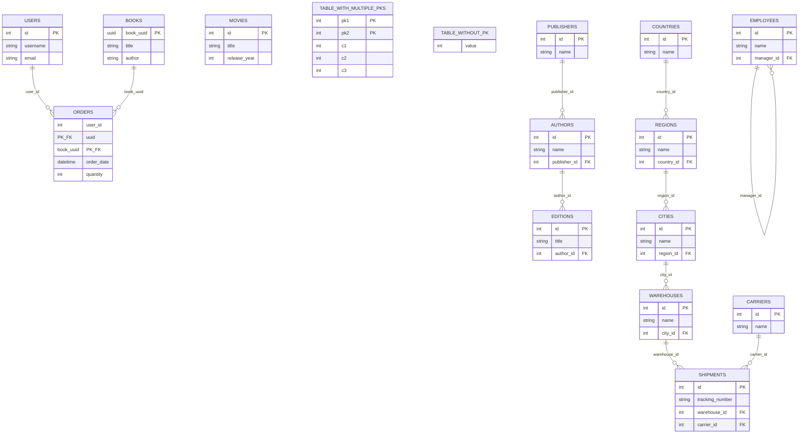

# Test fixture schema

Tables defined in `tests/test_functions.py::_populate_db` (and mirrored in
`seed.sql`). The test suite uses this schema to check FK-safe ordering,
primary-key handling, and diff correctness.

- `orders` has a depth-1 fan-in on two parents at once (`users` and `books`).
- `publishers -> authors -> editions` is a linear 3-deep FK chain.
- `publishers -> authors` alone is the 2-deep case, sharing tables with the chain above.
- `countries -> regions -> cities -> warehouses -> shipments` is a linear 5-deep FK chain.
- `shipments` also depends directly on `carriers` (an independent root table), so it has in-degree 2 from branches of different depth (depth-5 via warehouses, depth-1 via carriers) — a fan-in case for topo-sort testing.
- `employees.manager_id -> employees.id` is a self-referencing FK - a table-level topological sort has nothing meaningful to say about "employees before employees", so this edge is excluded from the table dependency graph rather than treated as a cycle (see `_build_table_graph` in `src/differ.py`).
- `movies` and `table_with_multiple_pks` carry no FKs (control cases).
- `table_without_pk` has no primary key at all - it exercises `check_deletions`/`check_insertions`/`check_updates` raising `NoPrimaryKeyError`, and `make_diff_patch` skipping it with a warning instead of aborting the whole diff.
